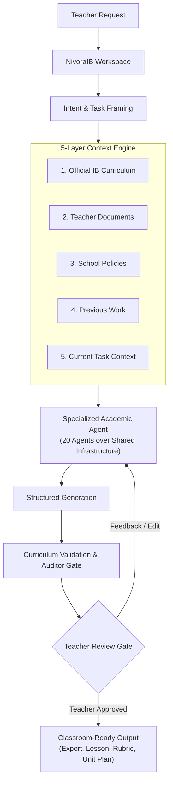

<div align="center">
  
  <h1>NivoraIB</h1>
  <p><strong>AI Workspace for IB Teachers</strong></p>
  <p>Plan, teach, assess, and manage teaching workflows in one intelligent workspace.</p>
  <p>
    <a href="https://www.nivoraib.com"></a>
    <a href="https://www.nivoraib.com"></a>
    <a href="https://www.nivoraib.com"></a>
    <a href="https://www.nivoraib.com"></a>
  </p>
</div>

---

> *"We started NivoraIB to help IB educators spend less time on repetitive planning and administrative work and more time teaching. We believe AI should support, not replace, teacher expertise. NivoraIB brings curriculum-grounded AI, resources, personalization, and teaching workflows into one intelligent workspace built around educators."*

---

## What is NivoraIB?

**NivoraIB is an AI-powered workspace that helps IB educators plan, teach, assess, and manage their teaching workflows in one place.**

Built specifically for International Baccalaureate (IB) Diploma Programme educators, NivoraIB streamlines unit planning, syllabus cross-referencing, command-term nuance, Internal Assessments (IA), and Criteria A–D rubrics.

NivoraIB is **AI-native, teacher-centered, curriculum-grounded, and workflow-oriented**:

* **Not a generic chatbot:** Every prompt is grounded in verified curriculum context before generation.
* **Not an LMS or ERP:** Focused entirely on teacher pedagogical workflow, not student database administration.
* **Not an AI wrapper:** Outputs are shaped by domain-specific agents and verified through deterministic auditor gates.

---

## Core Workflow & Context Engine

NivoraIB enforces a structured, context-first execution loop:

```
Teacher Request → Intent Framing → Retrieve Context → Specialized AI Agent → Structured Generation → Curriculum Validation → Teacher Review → Save / Edit / Export
```

### The 5 Context Layers

Before generation begins, relevant context is assembled across five layers:

1. **Official IB Curriculum:** Subject guides, SL/HL syllabus statements, command terms, and assessment criteria.
2. **Teacher Documents:** Personal notes, lesson archives, and teacher-authored guides.
3. **School Policies:** Internal deadlines, assessment schedules, and academic integrity policies.
4. **Previous Work:** Exemplars, prior formative assignments, and past moderation records.
5. **Current Task Context:** Course level (SL/HL), current unit topic, target objectives, and session constraints.



---

## Platform Verticals

* **Planning:** Unit planning (6-week scopes, pacing), lesson plans, learning objectives, and teaching sequences.
* **Curriculum Intelligence:** Real-time alignment against official IB subject guides, syllabus statements, command terms (*Analyze, Evaluate, Discuss*), and assessment expectations.
* **Teaching & Classroom Workflows:** Differentiated activities, inquiry lab guides, conceptual explanations, and reusable classroom materials.
* **Assessment:** Formative checkpoints, Criteria A–D rubrics, moderation matrices, prompt generation, and criterion-referenced feedback.
* **Resource Intelligence:** Unified semantic indexing of teacher documents, uploaded resources, past work, and school materials for instant retrieval.

---

## Specialized AI Agents

Rather than one generic assistant, **NivoraIB uses specialized academic agents operating over shared infrastructure.**

Currently, **20 specialized agents** operate across the platform, each tuned for specific tasks (such as lesson architecture, syllabus alignment, rubric creation, or inquiry scaffolding).

Shared infrastructure provides common capabilities across all agents:

* **Context Retrieval:** Fast semantic and keyword search across curriculum corpora and teacher materials.
* **Durable Task State:** Persistent checkpoints allowing multi-step execution without state loss.
* **Deterministic Verification:** Automated checks against course guidelines before teacher review.
* **Observability:** Telemetry tracking latency, token consumption, and agent decisions.
* **Teacher Controls:** Universal inline editing, feedback, and approval mechanisms.

---

## Built for Reliable AI Workflows

In academic settings, unverified AI outputs create risk. NivoraIB is engineered around an uncompromised invariant:

> **Generated ≠ Validated ≠ Teacher Approved ≠ Published**  
> *Generation is not completion.*

### Explicit Workflow Lifecycle

Every task transitions through explicit lifecycle states:

```
PENDING → IN_PROGRESS → GENERATED → VALIDATION_PENDING → AUDITOR GATE → VALIDATED → TEACHER_REVIEW → TEACHER_APPROVED → PUBLISHED
```

### Reliability Principles

* **Durable External Task State:** Workflows survive disconnections and long-running operations.
* **Independent Verification:** Dedicated checks verify syllabus fidelity and command-term compliance.
* **Auditor Gates:** Structural discrepancies or ungrounded claims are flagged before educator review.
* **Teacher Agency:** AI never publishes directly to students. The teacher retains final authority.
* **Core Philosophy:** **AI assists. Teachers decide.**

*Note: NivoraIB does not claim 100% accuracy or zero hallucinations. We build bounded, auditable systems where discrepancies are caught early and teachers remain firmly in control.*

---

## Technology & Architecture

* **Frontend:** Next.js, React, TypeScript, Tailwind CSS, shadcn/ui
* **Backend:** Python, FastAPI
* **AI & Orchestration:** LangGraph, LiteLLM, Pydantic, PydanticAI
* **Data & Storage:** PostgreSQL, Qdrant, Redis, Cloudflare R2
* **Infrastructure:** Docker, GitHub Actions CI/CD
* **Observability:** OpenTelemetry

---

## Company Information

* **Company:** NivoraIB
* **Positioning:** AI Workspace for IB Teachers
* **Founded:** 2026
* **Headquarters:** New Delhi, India
* **Website:** [https://www.nivoraib.com](https://www.nivoraib.com)
* **Status:** *NivoraIB is actively being developed as an AI-native workspace for IB educators.*

### Team

* **Deepak Sagar** — Founder ([LinkedIn](https://www.linkedin.com/in/deepak-sagar-6149723ba/))
* **Anshuman Singh** — Co-founder ([LinkedIn](https://www.linkedin.com/in/ansuman-singh-663b7a381/))
* **Harsh Raj** — Co-founder ([LinkedIn](https://www.linkedin.com/in/harsh-raj-81a133330/))
* **Gagandeep Singh** — AI Engineer ([LinkedIn](https://www.linkedin.com/in/gagandeep1278/))
* **Priyanshu Kumar** — Full Stack ([LinkedIn](https://www.linkedin.com/in/priyanshu-kumar0/))

---

## Contact & Inquiries

* **General:** [contact@nivoraib.com](mailto:contact@nivoraib.com)
* **Information:** [info@nivoraib.com](mailto:info@nivoraib.com)
* **School Partnerships:** [partnerships@nivoraib.com](mailto:partnerships@nivoraib.com)
* **Technical & DevOps:** [devops@nivoraib.com](mailto:devops@nivoraib.com)

---

<div align="center">
<small>
NivoraIB is an independent educational technology platform developed for teachers delivering the International Baccalaureate (IB) Diploma Programme. NivoraIB is not affiliated with, endorsed by, or sponsored by the International Baccalaureate Organization.
</small>
</div>
